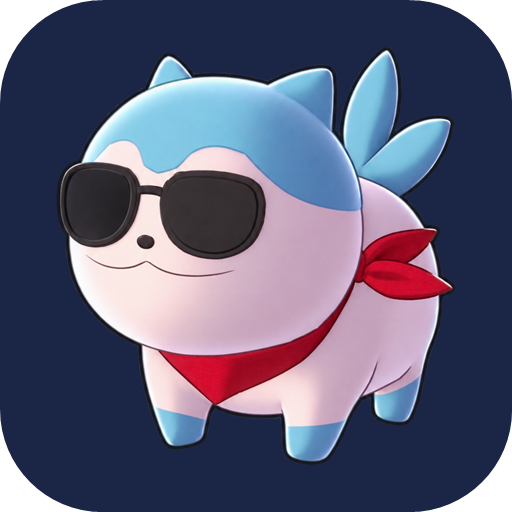

# Somniel

**Somniel runs Fire Emblem Engage (v2.0.0) natively on Android.** It is not an emulator and not a static recompilation:
the game's own AArch64 code runs directly on your phone's CPU, and Somniel supplies what sits underneath it (a
Horizon OS layer, an NVN-to-Vulkan renderer, audio, input and save data).

> **Early, experimental software.** Expect bugs. Please read [What to expect](#what-to-expect) before installing.

Somniel contains **no game files**. You need your own legally obtained copy of Fire Emblem Engage with the 2.0.0
update, and your own console keys. The first-run setup dialog walks you through picking them.

---

## Download and install

1. Download the latest APK from the [Releases page](https://github.com/teton-dev/somniel/releases).
2. Install it (allow installs from your browser or file manager if Android asks). To update, install over the existing
   app; **do not uninstall first**, or you lose the game data and saves stored in the app.
3. Open Somniel and follow the first-run setup to point it at your own game files and keys.
4. The first launch asks whether to share anonymous data (see below) and, on non-Adreno GPUs, shows a warning.

The first boot takes longer than later ones while the game's shaders are prepared in the background.

---

## Tested hardware

Somniel has only been tested on a Retroid Pocket 6, both 8GB and 12GB models, so it's built against the Snapdragon 8 Gen 2 SOC, where it maintains a relatively stable 60FPS. 

- **Mali and Xclipse GPUs are completely untested and are unlikely to work.** The renderer was built and verified
  against the Adreno 740 driver. On a non-Adreno device the app shows a warning on first boot; you can still try, but
  expect wrong graphics, bad performance, or the game not starting at all.
- Other Adreno GPUs and other Snapdragon chips are untested. They may work, and reports are welcome.
- Requires Vulkan 1.1 and Android 13 or newer is recommended.

---

## More about Somniel

- **Native execution.** The game's code runs at native speed rather than through an emulator or recompiler, which is
  what makes mods that hook real machine code possible, and what makes 60 fps realistic on handheld hardware.
- **Optimized rendering and threading.** Shaders are translated on the device the first time they are used and cached
  (and all of the game's shaders are prepared in the background on first boot, so later runs hitch less). The
  renderer replays the game's graphics commands on Vulkan and the game's own threads run truly in parallel.
- **Proper sleep and wake.** Lock the screen or switch apps and the game parks itself: guest threads pause, audio
  pauses and the CPU is idle. Unlock and it comes back where you left it.
- **Built-in 60 fps** (no speed-up). The frame-rate patch is built in and selectable live. See the sidebar below.
- **Hardware movie decoding.** The opening movie and cutscene video go through Android's hardware VP9 decoder.
- **In-game sidebar**, opened with Back (or the system back gesture), covering:
  - **Accurate frame-rate control:** 30, 40 or 60 FPS, applied immediately without restarting.
  - **Render scale:** 50% to 125% of the game's 1728x972 in 5% steps, applied live.
  - **Performance monitor:** FPS, frame times with a graph, CPU/GPU temperatures and clocks.
  - **Mods page:** import `.zip` or `.7z` mod archives, switch mod folders on and off, restart to apply.
- **Experimental Cobalt mod support.** Cobalt is bundled and installed for you, and its plugin (`.nro`) loader is
  implemented natively. See [Mods](#mods).
- **Custom GPU drivers:** import a driver package.

---

## Mods

Cobalt support is **experimental**.

- **Not all mods will work.** Mods that only replace game assets (LayeredFS-style romfs mods) are the most likely to
  work. Mods that ship code plugins (`.nro` or exefs patches) depend on hooks that may not be implemented yet, and some
  will do nothing or crash.
- **Do not install frame-rate or "60 FPS" mods.** 60 fps is built in and is controlled from the sidebar. A second
  patch on top of it will fight the built-in one and can cause crashes or wrong game speed.
- Changes to the mod list take effect after a restart, because Cobalt reads mods once at boot.
- If a mod misbehaves, turn it off in the Mods page and restart before reporting a bug against Somniel.

---

## What to expect

- **There will be bugs.** This is early software. It's very likely there are still rendering glitches on devices I have not tested yet, occasional stutter while shaders are first translated, and crashes in less common
  parts of the game.
- Performance is best on the Snapdragon 8 Gen 2 devices listed above. Long play sessions have had less testing than
  short ones.
- Save data lives in the app's own storage. Back it up before experimenting with mods or updating the app.
- Updating the app may require first-boot work again (such as preparing shaders) and may need a fresh game-data push.

---

## Anonymous reporting (opt-in)

On first boot Somniel asks whether you want to share anonymous performance and crash data. It is **off until you say
yes**, and you can change your mind in the sidebar at any time (declining also deletes anything queued).

- **Shared:** a random install ID (resettable), app version, device model, chipset and GPU names, Android version,
  RAM size, frame-rate totals, and, after a crash, the faulting library and offset.
- **Never shared:** your name, accounts, IP address (the server does not store it), file paths, save data or game files.

The data is used to find out which devices work and where it crashes.

---

## Reporting a bug

Open an issue on the [issue tracker](https://github.com/teton-dev/somniel/issues). Please include your device model, Android version, what you were doing, and `somniel.log` from the app's `files`
folder (`Android/data/dev.teton.somniel/files/`). Screenshots of rendering glitches help a lot.

---

## Credits and licences

Somniel builds on SDL3, volk, libadrenotools, Cobalt and the engage-pc-recomp project's NVN notes (MIT). The shader
translator is derived from Ryujinx. Fire Emblem is a trademark of Nintendo; Somniel is an unofficial fan project and is
not affiliated with or endorsed by Nintendo or Intelligent Systems.
