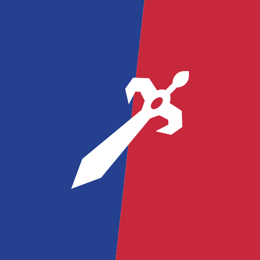

# Somniel

**Somniel runs Fire Emblem Engage (v2.0.0) natively on Android.** It is not an emulator: the game's own AArch64 code
runs directly on your phone's CPU, and Somniel supplies what sits underneath it (a Horizon OS layer, an NVN-to-Vulkan
renderer, audio, input and save data).

> **Early, experimental software, heavily assisted by Claude.** Expect bugs.

Somniel contains **no game files**. You need your own legally obtained copy of Fire Emblem Engage with the 2.0.0
update, and your own console keys. The first-run setup walks you through picking them.

---

## Download and install

1. Download the latest APK from the [Releases page](https://github.com/teton-dev/somniel/releases).
2. Install it. To update, install over the existing app or use **Check for updates** in the sidebar.
   **Do not uninstall first**, or you lose the game data and saves stored in the app.
3. Open Somniel and follow the first-run setup. The first boot is slower while shaders are prepared in the background.

---

## Requirements

| | |
| --- | --- |
| **Target** | 60 fps at native resolution on default settings: **Snapdragon 8 Gen 2** (Adreno 740) or better. |
| **Minimum** | **4 GB RAM** and a **Mali-G57 MC2** class GPU: about **25-30 fps in battles** and **20-25 fps in the Somniel hub** on the lowest settings. |
| **Software** | Vulkan 1.1; Android 13 or newer recommended. |

| Chip (GPU) | Result |
| --- | --- |
| Snapdragon 8 Gen 2 (Adreno 740) | Main target: a mostly steady 60 fps. |
| Dimensity 7300 (Mali-G615 MC2) | 30 fps in the handheld profile; the Somniel hub holds 29-30 fps. |
| Exynos 1330 (Mali-G68 MP2) | Playable, but 3D scenes run below 30 fps. |
| Dimensity 6300 (Mali-G57 MC2) | The minimum spec above. |

Other Adreno and Xclipse GPUs are untested; reports welcome. Mali support is early: Somniel starts Mali GPUs in the
handheld profile at 30 fps, and the Graphics page has settings that trade picture quality for speed.

---

## More about Somniel

Emulators have to recreate a console. Somniel only has to replace the parts of it the game talks to, which is where
most of the advantages come from.

### Rendering
- **No CPU emulation.** The game's code runs natively, with no JIT, translation or interpreter, so the CPU is rarely the
  bottleneck.
- **NVN straight to Vulkan.** The game's graphics calls map directly onto Vulkan with no Switch GPU model in between.
  The game's ~9,300 shader stages are translated to SPIR-V on the device, cached on disk and all prepared in the
  background on first boot, so later runs rarely compile mid-game.
- **Shaders per GPU.** They are translated for what your GPU supports (no clip distances on Mali, the GPU's own
  subgroup size), and textures the GPU can't read natively (BC on Mali-G68) are decoded on the CPU.
- **Native resolution control.** Render scale 50-125 %, 30/40/60 fps (plus 20 and 45), a handheld or docked profile,
  and **dynamic resolution** that steps down only when frames are missed. All applied live.

### Optimization
Smooth frame times matter more than a high average, and effects are not removed to get there.

- **Texture loading is about 1.5x faster.** Switch textures are stored in a swizzled "block-linear" layout; Somniel
  un-swizzles them in whole 16-byte runs and works out each block's address once, not once per pixel.
- **Pipeline look-ahead.** The pipelines a frame needs are found ahead of time and built together on several threads
  (first combat start on one Mali tablet: 602 ms down to 403 ms). Shaders from earlier sessions are rebuilt at the title
  screen.
- **Hitch fixes.** Somniel walking stalls (up to 500 ms) are now under about 50 ms; combat start on Adreno 740 went from
  up to 200 ms to about 60 ms.
- **Mali frame pacing.** Presenting no longer waits on the GPU, and a draw whose shader was late is no longer dropped.
- **Hidden object culling** skips objects fully hidden behind walls: Somniel shops went from about 25 to a steady
  29-30 fps on a Dimensity 7300.
- **Cheaper passes.** In handheld mode the final passes cover only the visible picture, the unit-info portrait follows
  render scale, and anti-aliasing can be turned off in every scene.
- **Dynamic game speed** keeps walking and game time normal when the device dips below your frame rate, down to 15 fps.
- **Lean overhead.** Guest threads run truly in parallel, per-call graphics timing is off by default, and Mali timings
  go to Android's performance hints.

### Mods
Because the game runs as real machine code in your process, mods that **hook native code** can work, which is out of
reach for most emulator setups. Somniel supports [Cobalt](https://github.com/Raytwo/Cobalt) (experimental), including
its plugin (`.nro`) loader, and loads mods from the SD-card layout Cobalt already uses.
- Cobalt is **not included** (its licence doesn't allow redistribution): accept the first-start prompt, or use
  sidebar, **Mods**, **Download latest Cobalt** / **Import Cobalt zip...**.
- Asset-only (LayeredFS-style) mods are the most likely to work; code plugins depend on hooks that may be missing.
- **Don't install "60 FPS" mods.** Frame rate is built in and will fight a second patch.
- Mod list changes need a restart. If a mod misbehaves, turn it off and restart before reporting a bug.

### Built for a phone
- **On-screen controls** with relative sticks and multi-touch, hidden automatically when a controller connects; size,
  opacity and layout are editable.
- **Dual-screen companion** (by igawa6): on handhelds with a second screen, a live battle map, unit details and
  rosters. Bundled and optional.
- **Proper sleep and wake**: lock the screen and the game parks itself with the CPU idle.
- **Hardware movie decoding** (convert-once to H.264 where there's no VP9 decoder), **save import/export**,
  **custom GPU drivers**, **in-app updates**, and a **performance monitor** (FPS, frame-time graph, temperatures,
  clocks).

---

## Notes

- There will be bugs: rendering glitches on untested devices, a stutter the first time a scene's shaders are prepared,
  and crashes in less common parts of the game. Back up your saves before updating or experimenting with mods.
- **Anonymous reporting is opt-in** and off until you say yes (changeable in the sidebar). It shares a resettable
  install ID, app version, device model, chip and GPU, Android version, RAM, frame-time totals and, after a crash, the
  faulting library and offset. Never your name, accounts, IP, paths, saves or game files.
- **Bugs:** open an [issue](https://github.com/teton-dev/somniel/issues) with your device, Android version, what you
  were doing, and `somniel.log` from `Android/data/dev.teton.somniel/files/`.

---

## Credits and licences

Somniel is free software under the [GNU General Public License v3.0](LICENSE). Bundled third-party code keeps its own
licence; see [THIRD_PARTY_NOTICES.md](THIRD_PARTY_NOTICES.md). Thanks to:

- **Dual-screen companion:** [igawa6](https://github.com/igawa6)'s
  [eden-duo-companions](https://github.com/igawa6/eden-duo-companions) and [Eden Duo](https://github.com/igawa6/eden-duo)
  SDK (GPL-3.0), bundled unmodified. Eden Duo is a fork of the [Eden](https://git.eden-emu.dev/eden-emu/eden) emulator.
- **Shader translator:** derived from [Ryujinx](https://github.com/Ryujinx/Ryujinx)'s shader compiler (MIT).
- **NVN notes and ASTC decoding:** [engage-pc-recomp](https://gitlab.com/engage-pc-recomp/engage-pc-recomp) by Valiantsin
  Dzerakh (MIT), whose ASTC decoder ports LAS Recomp's by Peiikai (MIT).
- **60 fps:** follows the "60 FPS (no Speedup)" patch by systemdev, zeusiota and dogethis
  ([GameBanana](https://gamebanana.com/mods/432758)).
- **[SDL3](https://www.libsdl.org/)** (zlib), **[volk](https://github.com/zeux/volk)** (MIT),
  **[libadrenotools](https://github.com/bylaws/libadrenotools)** (BSD-2-Clause), **[bcdec](https://github.com/iOrange/bcdec)**
  (MIT); companion dependencies [LZ4](https://github.com/lz4/lz4) (BSD-2-Clause), `bc_decoder` (MPL-2.0) and
  [stb_truetype](https://github.com/nothings/stb) (MIT or public domain).
- **Mods:** [Cobalt](https://github.com/Raytwo/Cobalt) by Raytwo, downloaded separately.
- **App icon:** placeholder using the Fire Emblem series symbol artwork by Toomai Glittershine (SmashWiki).

Fire Emblem is a trademark of Nintendo; Somniel is an unofficial fan project and is not affiliated with or endorsed by
Nintendo or Intelligent Systems. Somniel and the companion are not affiliated with or endorsed by the Eden project.
